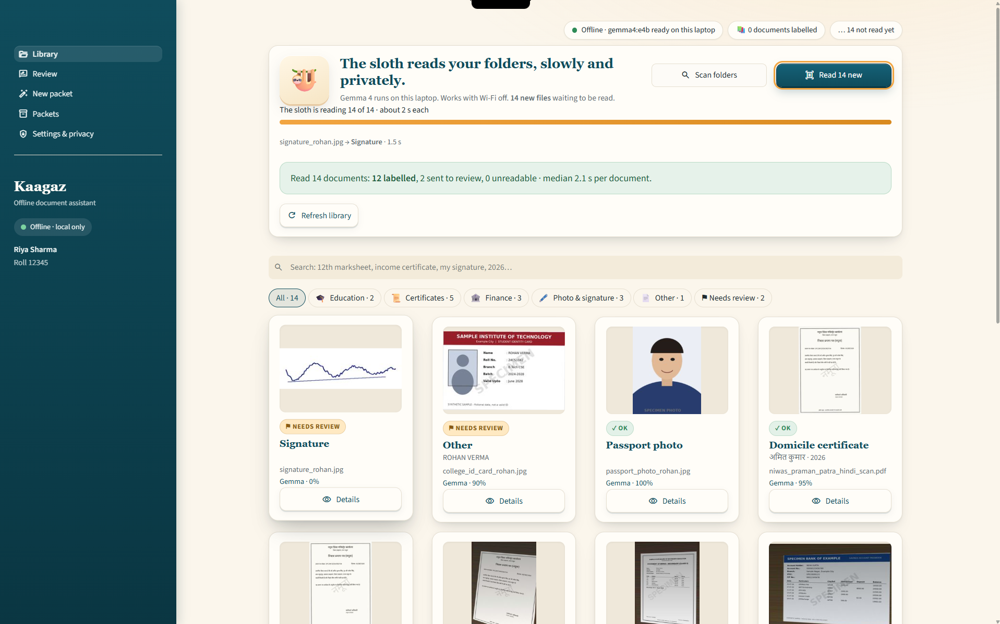
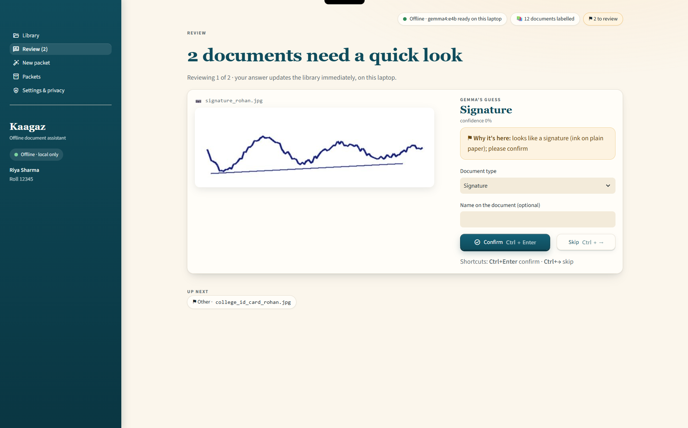
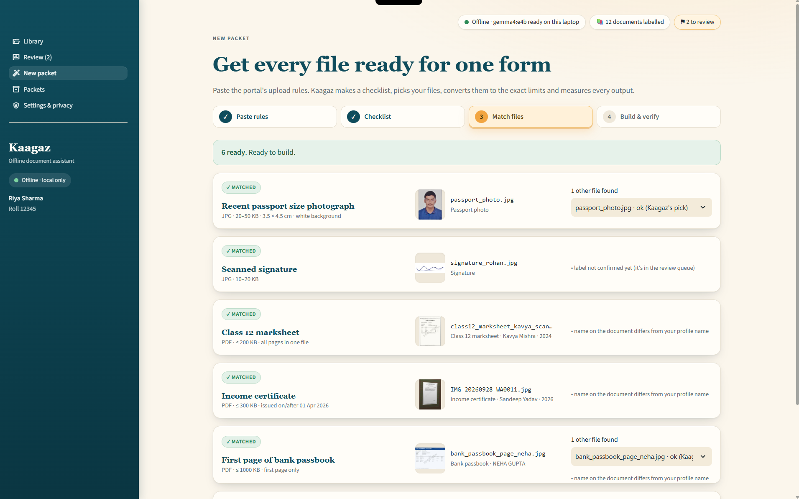
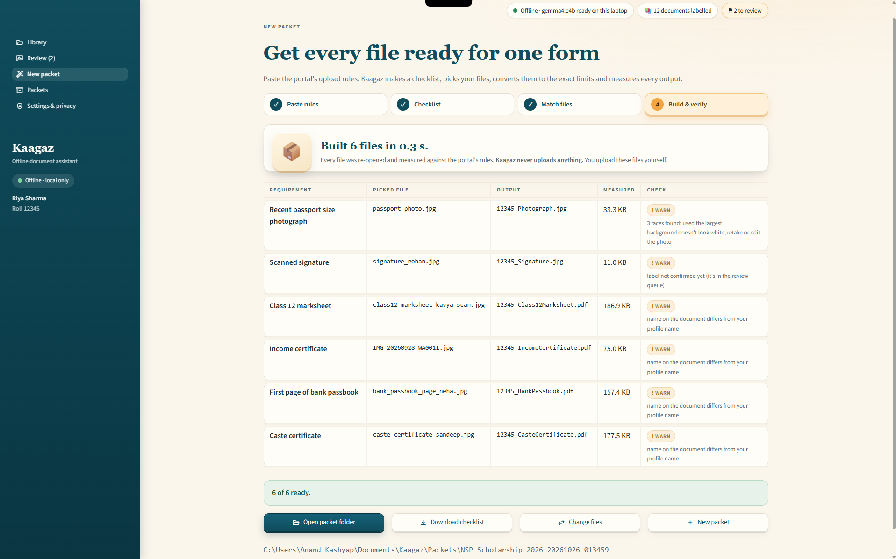

# Kaagaz 📄🦥

# Kaagaz 📄🦥

**Your documents, ready for any form. Offline.**

Every scholarship, admission and exam portal in India wants the same documents in a different
format: "photo 3.5 × 4.5 cm, JPG, 20–50 KB", "marksheet PDF under 200 KB", "income certificate
issued on or after 01 April". Kaagaz reads your folders, recognises each document with
**Gemma 4 E4B running locally through Ollama**, and when you paste a portal's upload
instructions it builds a folder of files converted, cropped, compressed and renamed to the exact
rules. Then it **re-opens and measures every output**, and tells you what's missing or expired
before you start the form.

> **AI decides *what*. Code does *how*. Code verifies.**

Nothing leaves your laptop. No uploads, no online compressors, no cloud API.

📖 **Guide:** [kaagaz guide page](https://YOUR-VERCEL-URL) (setup, how to use, results, troubleshooting)

Built for the DEV Hacktoberfest Open-Source AI Challenge, Week 3 ("Slow and Steady"),
Oct 22–25, 2026.

---

## What it does

| Step           | What happens                                                                                                                          | Who does it                            |
| -------------- | ------------------------------------------------------------------------------------------------------------------------------------- | -------------------------------------- |
| 1. Scan        | Reads your chosen folders (read-only), skips files it has seen (sha256)                                                               | Code                                   |
| 2. Label       | Looks at page 1 of each document and returns type, name, issuer, year, dates as schema-checked JSON. Unsure ones go to a review queue | **Gemma 4 E4B**                  |
| 3. Paste rules | Turns a portal's "documents to upload" text into an editable checklist                                                                | **Gemma 4 E4B**, checked by code |
| 4. Match       | Picks the best file for each row; flags MISSING, EXPIRED, CHECK DATE                                                                  | Code (plain rules)                     |
| 5. Build       | Converts, face-crops, compresses to the KB limit, renames                                                                             | Code                                   |
| 6. Verify      | Re-opens every output and measures format, KB, pixels, pages: PASS / WARN / FAIL                                                      | Code                                   |

A file that fails verification is **never written** to the packet, so you can't upload it by mistake.

## Screenshots

| Library                                  | Review                                 | Match                                | Build                                |
| ---------------------------------------- | -------------------------------------- | ------------------------------------ | ------------------------------------ |
|  |  |  |  |

All documents shown are **specimens** with invented details (generated by `samples/make_specimens.py`).

## Requirements

- Windows 11 (developed on an ASUS ROG Strix G16)
- NVIDIA GPU with **6 GB+ VRAM** and a current driver (check with `nvidia-smi`)
- Python 3.12
- [Ollama](https://ollama.com)

## Setup

```powershell
ollama pull gemma4:e4b

git clone https://github.com/kashyapanand21/kaagaz.git
cd kaagaz
py -3.12 -m venv .venv
.venv\Scripts\Activate.ps1          # your prompt should now start with (.venv)
pip install -e ".[ui,dev]"

kaagaz doctor                        # checks Ollama, the model and a JSON round-trip
kaagaz ui                            # opens the app at http://127.0.0.1:8501
```

On first run the app asks for the folders to read, your name (used to prefer your documents over
family members') and your roll number (used in file names). Settings are saved to `config.toml`,
which is git-ignored. `config.example.toml` shows every option.

## Using it

**App (`kaagaz ui`):** Library → Review → New packet (paste rules → checklist → match → build)
→ Packets → Settings & privacy. The [guide page](https://YOUR-VERCEL-URL) walks through each screen.

**Command line**, same code as the app:

```powershell
kaagaz scan                                   # register new files (fast, no AI)
kaagaz classify                               # label them with Gemma (~2 s each; safe to stop)
kaagaz parse rules.txt --save nsp.json        # portal text -> editable checklist
kaagaz match nsp.json                         # best file per row, missing/expired
kaagaz build nsp.json --name "NSP 2026"       # build and verify the packet
```

To try it without your own documents:

```powershell
python samples\make_specimens.py D:\kaagaz-demo     # invented documents for "Riya Sharma"
```

Add that folder in Settings, then use `samples/instructions/nsp_specimen.txt` as the portal rules.
Expected result: **4 ready · 1 expired · 1 missing** (add a real photo of yourself as
`passport_photo.jpg` for the photo row).

## Measured results

On an RTX 4050 Laptop GPU (6 GB), Ollama, `gemma4:e4b`:

| Metric                                  | Value                                                     |
| --------------------------------------- | --------------------------------------------------------- |
| GPU memory during a vision call         | 4.5 GB of 6 GB                                            |
| Time per document, warm                 | median 2.1 s, p95 3.0 s                                   |
| Model cold load                         | ~14 s                                                     |
| Building a 6-file packet                | 0.3 s                                                     |
| Requirement parser, specimen rules text | 27 / 27 limits (v1: 22 / 27)                              |
| Dev set, 13 specimen documents          | 13 / 13 handled correctly (11 labelled, 2 sent to review) |
| Tests                                   | 71, none need a GPU                                       |

**Honesty note:** the specimen and dev-set documents were made by me, so those two rows are a
smoke test, not a benchmark. The full story, including what failed, is in [DEVLOG.md](DEVLOG.md).

## How Gemma is used, and checked

- **One door to the model:** every call goes through `chat_json()`: `think=False` (thinking cost
  ~5 s per document for no gain), `num_ctx=8192`, `keep_alive=15m`, temperature 0, and a JSON
  schema from Pydantic with **every key required** (optional keys let the model skip fields).
- **The model reads, code converts:** Gemma copies sizes and dates exactly as printed; tested code
  turns "0.3 MB" into 300 KB and "14-06-2022" into a date (day-first, Devanagari digits supported).
- **Code checks the model in both directions:** every number Gemma returns must appear in the
  sentence it quotes (*grounding*), and every number-with-unit in that sentence must be used
  (*coverage*). Invented and missed limits are both flagged for you.
- **Three review triggers:** type `other`, confidence below 0.75, or the PDF's own text naming a
  different type. A visual ink check suggests "signature" when Gemma says "other", but never
  overrides it silently.

## Privacy

- The only network connection is Ollama on `127.0.0.1`. If the model host is set to anything
  else, Kaagaz refuses to start.
- Streamlit's usage statistics are turned off and the app only listens on `127.0.0.1`
  (`.streamlit/config.toml`).
- Aadhaar, PAN and account numbers are stored as the **last 4 digits only**: enforced by a
  validator, plus a scrubber on every saved field, including raw model output.
- Your original files are never changed, moved or deleted. Outputs go to
  `Documents\Kaagaz\Packets`.
- Settings → **Delete all Kaagaz data** removes the database, thumbnails and saved checklists.

## Troubleshooting

| Problem                                                                  | Fix                                                                                                                                                                                                                                                                                                                 |
| ------------------------------------------------------------------------ | ------------------------------------------------------------------------------------------------------------------------------------------------------------------------------------------------------------------------------------------------------------------------------------------------------------------- |
| `kaagaz` is not recognized                                             | Activate the venv: `.venv\Scripts\Activate.ps1`                                                                                                                                                                                                                                                                   |
| "The local AI isn't running"                                             | Start the Ollama app; `ollama pull gemma4:e4b`                                                                                                                                                                                                                                                                    |
| Slow labelling                                                           | `ollama ps` must say `100% GPU`. On ROG laptops, Armoury Crate "Eco" mode turns the NVIDIA GPU off                                                                                                                                                                                                              |
| OneDrive files skipped                                                   | Right-click the folder → *Always keep on this device* (online-only files would download from the cloud)                                                                                                                                                                                                          |
| Model fails to load: `CUDA error: shared object initialization failed` | Seen after Ollama auto-updated to 0.40.11 (crash in its CUDA 13 backend during warm-up). Kaagaz retries 3 times, then pauses without losing work. Workaround: quit Ollama from the tray, run `setx OLLAMA_LLM_LIBRARY cuda_v12`, start Ollama, open a new terminal. Otherwise reinstall an earlier Ollama release |

## Known limitations

- Name matching is word-based, so a Devanagari name doesn't match an English profile name yet.
- Photo backgrounds are checked, not replaced.
- Separate front and back photos aren't merged into one PDF automatically.
- E4B only: on a 6 GB GPU, Gemma 4 12B doesn't fit, so unsure labels go to review instead of a
  bigger model.
- Tested on Windows 11 with an NVIDIA GPU only.

## Project layout

```
src/kaagaz/
  config.py      settings; Ollama host must be localhost
  schemas.py     DocType, Extraction, RequirementItem (shared contract)
  dates.py       day-first date parsing
  db.py, scan.py SQLite library, two-phase resumable scan
  engine/        transform, facecrop, validate, naming, render, inkcheck, cleanup  (no AI)
  ai/            client, requirements, classify, scrub
  packets/       validity, matcher, builder, checklist
  cli.py         Typer commands
ui/              Streamlit app (offline: no CDN, no web fonts)
docs/            guide page
samples/         specimen generator + specimen portal rules
tests/           71 tests, no GPU needed
```

## Credits

- [Gemma 4](https://ai.google.dev/gemma) by Google
- [Ollama](https://ollama.com)
- [PyMuPDF](https://pymupdf.readthedocs.io) (AGPL-3.0)
- [Pillow](https://python-pillow.org), [pillow-heif](https://github.com/bigcat88/pillow_heif)
- [OpenCV](https://opencv.org) and its Haar cascade face detectors
- [Pydantic](https://docs.pydantic.dev), [Typer](https://typer.tiangolo.com),
  [Streamlit](https://streamlit.io)
- Built with help from Claude (Anthropic) as a pair programmer

## License

Apache-2.0. See [LICENSE](LICENSE).

Kaagaz depends on PyMuPDF, which is licensed under AGPL-3.0. Distributing Kaagaz together with
PyMuPDF is subject to PyMuPDF's licence terms.

## Commits after the deadline

The challenge deadline was Oct 25, 2026, 11:59 PM PDT. Any commit after that is listed here.

- *(none ye*

**A local, offline document assistant for Indian forms.**

Every scholarship, admission and exam portal in India wants the same documents in a different
format: "photo 3.5 × 4.5 cm, JPG, 20–50 KB", "marksheet PDF under 200 KB", "signature on white
background". Kaagaz scans your folders, recognises your documents with **Gemma 4 running locally
through Ollama**, and when you paste a portal's upload instructions, it builds a folder of files
converted, cropped, compressed and renamed to the exact rules. Then it **measures every output**.

> **AI decides *what*. Code does *how*. Code verifies.**

Nothing leaves your laptop. No uploads, no online compressors, no cloud API.

> 🚧 **Work in progress.** Built for the DEV Hacktoberfest Open-Source AI Challenge, Week 3
> ("Slow and Steady"), Oct 22–25, 2026.

---

## Status

| Part                                                                                    | State             |
| --------------------------------------------------------------------------------------- | ----------------- |
| Document engine: JPEG/PDF fitting to KB limits, face crop, image↔PDF, merge, validator | ✅ done, 16 tests |
| Config with localhost-only model host                                                   | ✅ done           |
| Requirement parser (portal instructions → checklist)                                   | 🔨 in progress    |
| Scan + classify with Gemma 4 E4B                                                        | ⏳ next           |
| Matcher + packet builder + CLI                                                          | ⏳                |
| Streamlit UI                                                                            | ⏳                |
| Evaluation numbers                                                                      | ⏳                |

## How it works

1. **Scan.** Kaagaz reads your chosen folders (read-only) and skips files it has already seen
   (sha256).
2. **Label.** Gemma 4 E4B looks at each document and returns a type (`marksheet_12`,
   `income_certificate`, `photo`, …), plus the name, issuer and year, as schema-checked JSON.
   Unsure results go to a review queue.
3. **Paste rules.** Paste a portal's "documents to upload" section, and Kaagaz turns it into an
   editable checklist.
4. **Build.** Kaagaz picks a file for each row, then plain Python converts, crops, resizes,
   compresses and renames it.
5. **Verify.** Every output is re-opened and measured: **PASS / WARN / FAIL** with real numbers
   (e.g. `46.2 KB, 413×531 px, PASS`). Missing and expired documents are flagged before you start
   the form.

## Requirements

- Windows 11 (developed on an ASUS ROG Strix G16)
- NVIDIA GPU with **6 GB+ VRAM** and a current driver (check `nvidia-smi`)
- Python 3.12
- [Ollama](https://ollama.com)

## Setup

```powershell
ollama pull gemma4:e4b

git clone https://github.com/YOUR_USERNAME/kaagaz.git
cd kaagaz
py -3.12 -m venv .venv
.venv\Scripts\Activate.ps1
pip install -e ".[ui,dev]"

copy config.example.toml config.toml   # then edit folders and profile
kaagaz config                          # show effective settings
pytest -q                              # engine tests, no GPU needed
```

Check that the model runs fully on your GPU:

```powershell
ollama run gemma4:e4b "ready?"
ollama ps        # PROCESSOR should say 100% GPU
```

## Measured so far

On an RTX 4050 Laptop GPU (6 GB):

| Metric                           | Value                   |
| -------------------------------- | ----------------------- |
| VRAM during a vision call        | 4.5 GB, 100% GPU        |
| Per document, warm, thinking off | ~6.5 s                  |
| Model cold load                  | ~13.7 s (once per scan) |

Full evaluation (accuracy, parsing, compliance, time saved) coming.

## Privacy

- The only network peer is Ollama on `127.0.0.1`. A non-local host is rejected when the config
  loads.
- Your original files are never modified, moved or deleted. Outputs go to a separate packets
  folder.
- ID numbers are stored as the **last 4 digits only**, enforced in code.
- All demo material uses **specimen documents** with invented details.

## Credits

- [Gemma 4](https://ai.google.dev/gemma) by Google
- [Ollama](https://ollama.com)
- [PyMuPDF](https://pymupdf.readthedocs.io) (AGPL-3.0)
- [Pillow](https://python-pillow.org), [pillow-heif](https://github.com/bigcat88/pillow_heif)
- [OpenCV](https://opencv.org) and its Haar cascade face detector
- [Pydantic](https://docs.pydantic.dev), [Typer](https://typer.tiangolo.com),
  [Streamlit](https://streamlit.io)

## License

Apache-2.0. See [LICENSE](LICENSE).

Note: Kaagaz depends on PyMuPDF, which is licensed under AGPL-3.0. Distributing Kaagaz together
with PyMuPDF is subject to PyMuPDF's licence terms.
